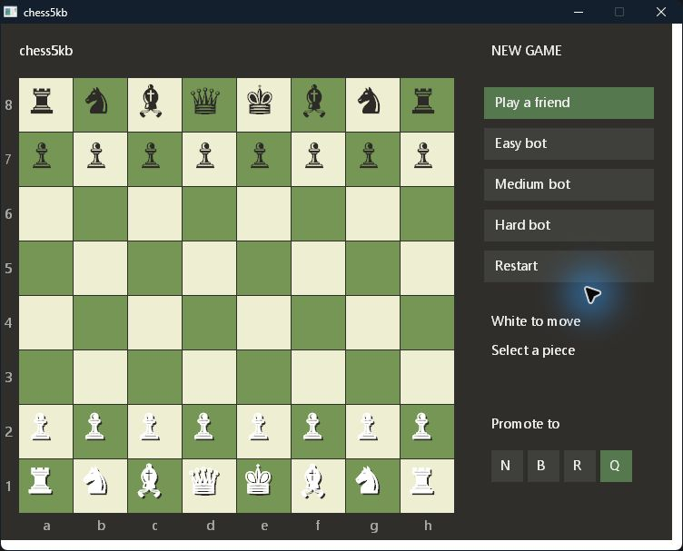

# chess5kb

A storage optimisation project: a playable native Windows chess game with a graphical board, three bot levels, and local two-player mode in **4,932 bytes**. The entire game executable is below **5,000 bytes**.

Inspired by the small-executable mindset of projects such as *.kkrieger*, this experiment explores how much functionality can fit into a tiny executable by sharing code, generating simple visuals, and using facilities already provided by Windows.

[Download chess5kb.exe](bin/chess5kb.exe)



## What fits inside

- Click-to-move chess with legal move and capture indicators.
- Easy, medium, and hard bots using one, two, and three plies of search.
- Two friends playing on the same computer.
- Selection and last-move highlights, a red king square for check, and check/checkmate/stalemate status.
- Castling, en passant, and promotion to a knight, bishop, rook, or queen.
- A green and cream board, chess piece glyphs, coordinates, and a compact control panel.

The layout and palette take inspiration from familiar online chess interfaces, including Chess.com. No Chess.com artwork, code, or online services are included; pieces are drawn with the system's font.

## Run and play

Download `bin/chess5kb.exe` and double-click it on Windows. The executable contains all game logic and UI code. It needs no game sidecar files, downloaded code, .NET installation, emulator, or additional assets.

This is a 32-bit x86 Windows executable. It uses standard Windows DLLs and the installed Segoe UI / Segoe UI Symbol fonts. On 64-bit x86 Windows it runs through the operating system's built-in 32-bit compatibility support. Only the current development host has been tested; this is not a claim of compatibility with every Windows version or architecture.

Click a piece to show its legal destinations, then click a destination to move. Dots mark empty destinations; dots near a piece's corner mark legal captures. Select another friendly piece to change the selection.

| Control | Behaviour |
| --- | --- |
| **Play a friend** | Start a new local two-player game. |
| **Easy bot** | Start a new game against a one-ply bot. You play White. |
| **Medium bot** | Start a new game against a two-ply bot. You play White. |
| **Hard bot** | Start a new game against a three-ply bot. You play White. |
| **Restart** | Restart in the current mode. |
| **Promote to: N / B / R / Q** | Choose the promotion piece before moving a pawn to its final rank. Q is the default and is restored after promotion. |

To castle, move the king to its destination square. The difficulty names describe relative search depth; they do not imply rated Elo strength.

## The byte budget

The published executable is **4,932 bytes**, counting its headers, imports, graphical interface, chess engine, and relocation data. It is below both decimal 5 KB (5,000 bytes) and binary 5 KiB (5,120 bytes).

| Component | Bytes |
| --- | ---: |
| PE headers | 512 |
| Windows API imports | 635 |
| Graphical interface and text | 2,127 |
| Chess rules and bot search | 1,536 |
| Relocation table | 122 |
| **Complete executable** | **4,932** |

The limit applies to the executable's logical file length. Filesystem allocation can make its reported “size on disk” larger. Process memory, the Windows DLLs and fonts already installed on the computer, source code, screenshots, and development tools are outside this file-size measurement.

## How storage was reduced

### Handwritten assembly and direct Windows calls

The game is written in 32-bit x86 assembly for FASM. It calls Win32 APIs directly and has its own entry point and message loop. There is no C/C++ startup code, bundled runtime, framework, browser engine, or general-purpose UI toolkit in the executable.

The result is assembled directly as a PE executable. Code, imports, initialized data, and relocations share a single section, reducing the headers and alignment gaps that separate sections would introduce.

### Use the operating system's drawing and fonts

GDI draws rectangles, circles, and text. The board is generated by looping over its squares; square colours, highlights, legal move dots, and coordinates are computed as needed. Chess pieces use Unicode glyphs from Segoe UI Symbol, with a small offset pass to distinguish the white pieces.

This replaces stored piece sprites, board textures, image decoders, embedded fonts, and resource bundles. Stock GDI objects also avoid storing or creating a separate drawing object for every square colour. The tradeoff is a dependency on Windows' rendering and installed fonts, rather than identical artwork on every computer.

### Share the chess machinery

One chess core drives move acceptance, legal move hints, check detection, mate/stalemate status, and bot search. The three bot levels change the search depth; they share the same search and evaluation code.

The core uses a compact **0x88 board**: a 128-slot representation where a bit test detects an off-board square. The extra unused slots cost a little memory but simplify move-generation instructions. Piece type, colour, and whether a piece has moved fit into one byte. Starting pieces are generated from a short back-rank pattern, and sliding moves reuse a small direction table.

### Reserve working memory without storing it

Board state, UI state, and buffers are created in memory. The assembly reserves 8,192 bytes of uninitialized state after the file's initialized data; those bytes consume address space at runtime without adding 8,192 bytes to the executable. Search also uses stack frames rather than embedded position databases.

### Trim padding while keeping relocations

FASM initially emits alignment padding. The build script finds the end of the relocation directory, checks that every following byte is zero, and removes only that final padding. It updates the section's raw size and retains the complete relocation table.

Keeping relocations matters: an earlier console prototype exposed a problem on a Windows configuration that required image relocation. This version spends 122 bytes on relocation data instead of relying on a fixed load address. The build also clears the PE timestamp and checksum for reproducible metadata; this does not itself save bytes.

### Keep the scope small

Short labels, a fixed board layout, a few simple drawing routines, and a small material evaluation keep code and data compact. Features such as networking, saved games, clocks, animations, sound, skins, and opening databases are omitted.

The release does **not** use executable compression, a self-extracting payload, a launcher that fetches a larger game, or an external chess engine. Compression was explored during the earlier console experiment, but a compressed payload alone is not a complete executable: a usable build must also include the loader, decompressor, headers, and imports.

## Workarounds and tradeoffs

The original target was a complete native Windows game under 1 KB. That target was not achieved. A larger console prototype preceded this GUI version, and the budget was revised to 5 KB. DOS executables requiring an emulator and tiny launchers pointing to a larger game were excluded from the accepted scope.

Using Windows' existing APIs and fonts is the main storage workaround. The game's move validation, bot, and UI logic remain inside this executable, while common OS functionality is shared. This is a measure of application file size, not of the total software needed to run a computer.

The single PE section is readable, writable, and executable. That keeps the layout compact, but gives up the code/data page-permission separation normally expected in a larger application. This repository is a size-coding experiment, not a hardened application template.

## Limitations

- **Draw rules:** automatic repetition, move-count, and dead-position draw adjudication are omitted. Stalemate is detected.
- **Bot strength:** the bot uses a simple material evaluation and shallow deterministic search. It has no opening book, positional evaluation, transposition table, or tablebases. “Hard” is only the deepest of these three small bots.
- **Promotion:** humans can choose N/B/R/Q; the bot always promotes to a queen.
- **Local play:** friend mode means sharing one computer. There is no online play.
- **Interaction:** bot search runs on the UI thread, so the window can stop responding while a move is calculated. There is no undo, game history, save/load, clock, board rotation, or choice to play Black against the bot.
- **Display:** the window uses a fixed layout and system fonts. Broad testing across DPI settings, font configurations, accessibility settings, and Windows versions has not been performed.

## Verification

The chess core passed **34 scenarios** against `python-chess`. These compared complete legal source/destination sets and all 4,096 source/destination queries per scenario, including castling rights and attacked paths, en passant pins and expiry, all promotion choices for both colours, checkmate, and stalemate. Starting-position move-tree counts were **20**, **400**, and **8,902** at depths 1–3.

The 4,935-byte native GUI prototype passed **14 mouse/visual checks** covering board rendering, piece selection and reselection, legal hints, illegal-move rejection, captures, check and its removal, a complete local game ending in checkmate, blocked moves after mate, all three bot replies, mode switching, restart, and promotion selection. Actual promotion execution was verified in the separate core tests; the GUI selector was checked separately.

The published 4,932-byte build was rebuilt after renaming the executable, window title, and registered window class to `chess5kb`. Its chess core and GUI behavior are shared with that tested prototype, but the files are not byte-identical. Build sanity checks on the renamed release confirm its size and SHA-256, 32-bit x86 GUI headers, single-section layout, and complete 122-byte relocation table containing 57 relocations. These build checks do not repeat the earlier 14 interaction checks on the final bytes.

The reports are retained as evidence of the tested scenarios, not an exhaustive correctness proof:

- [Chess rules report](tests/reports/rules.json)
- [GUI interaction report](tests/reports/gui.json)
- [Final release build report](tests/reports/release.json)

## Build from source

Requirements: Windows, PowerShell, and **FASM 1.73.35**.

From the repository directory:

```powershell
& .\build.ps1 -Fasm 'C:\path\to\FASM.EXE'
```

The default output is `bin/chess5kb.exe`. To choose another destination:

```powershell
& .\build.ps1 -Fasm 'C:\path\to\FASM.EXE' -Output '.\my-chess-build.exe'
```

The script assembles a temporary executable, validates its expected single-section layout and relocation data, trims only zero padding, and rejects a result of **5,000 bytes or more**. It prints the final size and SHA-256 hash. Only the resulting executable is needed to play.

```text
chess5kb.asm       PE entry point, Windows imports, and section layout
core32.inc        Chess rules, legal moves, evaluation, and bot search
gui32.inc         Win32 event handling and GDI drawing
build.ps1         Build, validate, trim, and enforce the size limit
bin/chess5kb.exe   Published game
docs/preview.png  Screenshot
tests/reports/    Recorded rule and GUI verification results
```
